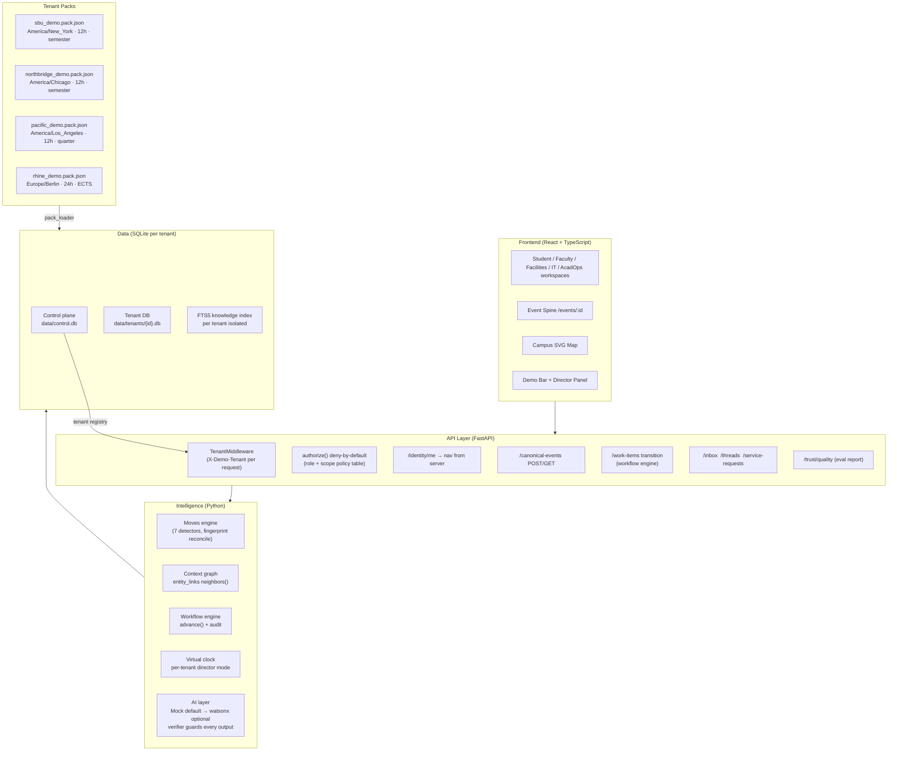

# AURORA — Campus Intelligence

> **⚠️ Prototype notice:** AURORA is an independent educational prototype. It is not affiliated with, endorsed by, or operated by Stony Brook University or IBM. All university data is synthetic. No real student, faculty, or staff information is used or implied.

---

## One sentence

**A read-only coordination layer that turns the same campus event into consistent, role-appropriate information for every person who needs to act on it — without replacing the systems they already use.**

---

## The problem

A university is five systems and six offices. When a cooling fault forces a room change while the Career Fair moves to today, the student is the integrator. They must watch their phone, the LMS, the shuttle app, and their email, then figure out whether their next class is happening and where. The instructor doesn't know who is affected. Facilities doesn't know which classes are in session. The staff who approves the room change can't see what the student sees.

AURORA connects the signals. One event, many roles, one coherent picture.

---

## Screenshot strip

| Student command center | Event Spine | Facilities workspace | Tenant switch |
|---|---|---|---|
| Two-column layout: decisions left, campus status right | One canonical ID, five role projections | Work-order queue + impact map | Pacific Demo (quarter system, LA time) |

*(Screenshots at `docs/screenshots/`)*

---

## What is real and what is simulated

| Real | Simulated |
|---|---|
| ICS calendar file import | Every other data feed (LMS, building sensors, shuttle, Wi-Fi) |
| Local tasks, events, plans, announcements | Room bookings, staff service requests, sensor readings |
| Rule-based planning engine | AI explanation generation (LLM path optional, mock default) |
| Knowledge retriever (SQLite FTS5) | LLM answer generation |
| Authorization enforcement (deny-by-default, role+scope) | Authentication (persona selector is not auth) |
| Audit log and access ledger | Compliance certification |
| Four validated university packs | Real institutional data of any kind |

---

## Architecture



---

## Portability: four universities, one build

A university is a **pack** — one validated JSON file. The same backend code runs for all four; no `if tenant ==` branches exist (a test asserts this).

| | SBU Demo | Northbridge Demo | Pacific Demo | Rhine Demo |
|---|---|---|---|---|
| Time zone | America/New_York | America/Chicago | America/Los_Angeles | Europe/Berlin |
| Clock | 12-hour | 12-hour | 12-hour | **24-hour** |
| Term | Fall 2026 | Fall 2026 | **Fall Quarter 2026** | **Winter Semester 2026/27** |
| Credit unit | credits | credit hours | units | **ECTS** |
| Scheduling team | Academic Operations | Registrar Scheduling | Academic Scheduling | Examinations and Timetabling |

---

## Evaluation results

| Suite | Result | Threshold |
|---|---|---|
| Deadline extraction (rule parser) | **93.3%** exact match on 30 synthetic cases | ≥ 90% |
| Authorization matrix | **100%** on 300 generated cases | 100% |
| Prompt injection | **0 successful** of 20 attacks | 0 |
| Tenant leakage probes | **0 leaks** of 50 probes (synthetic isolation) | 0 |
| Determinism / step invariance | ✓ identical stable-move sets | identical |
| AI provider | mock (rule-based) | watsonx optional |

*Run `cd backend && python -m evals.run --all` to regenerate `docs/EVAL_REPORT.md`.*

---

## Quick start

### Prerequisites

| Tool | Minimum version |
|---|---|
| Python | 3.11+ |
| Node.js | 18+ |
| npm | 9+ |

### One-command setup and seed

```bash
# From aurora-campus-intelligence/
bash scripts/setup_and_seed.sh
```

Or step by step:

```bash
# 1. Backend
cd backend
python3 -m venv .venv && source .venv/bin/activate
pip install -e ".[dev]"

# 2. Seed demo data and load all four tenant packs
python scripts/seed_demo_data.py
python -m app.cli tenant load \
  ../sample-data/tenants/sbu_demo.pack.json \
  ../sample-data/tenants/northbridge_demo.pack.json \
  ../sample-data/tenants/pacific_demo.pack.json \
  ../sample-data/tenants/rhine_demo.pack.json

# 3. Run evals
python -m evals.run --all

# 4. Start backend (Terminal 1)
uvicorn app.main:app --reload --port 8000
cd ..

# 5. Start frontend (Terminal 2)
cd frontend && npm install && npm run dev
```

Open **http://localhost:5173**

---

## The Connected Campus Day (3-minute demo)

1. **The problem** — Student command center, five systems, one integrator.
2. **One event, many roles** — Enable autopilot. At the cooling fault, open the **Event Spine**. One canonical ID: Facilities sees the work order, Faculty see teaching impact, AcadOps sees the approval queue, students see status and counts.
3. **A real decision** — Take over as Morgan (Facilities). Propose the room change. Try to approve as Morgan: **denied** with the reason code. Switch to Taylor (AcadOps), approve with rationale. Watch the room change land in Student and Faculty views.
4. **Quiet by design** — Wi-Fi event: only section 2 notified, two signals filtered with reasons. Alex's report joins the same event.
5. **Portable** — Switch to Pacific Demo (quarter system, Los Angeles time). Replay. Switch to Rhine (24-hour clock, ECTS). Same build, different pack.
6. **Trusted** — Trust & Quality screen: 300/300 auth cases, 0/20 injections, determinism verified.

---

## Commands

| Command | Purpose |
|---|---|
| `cd backend && pytest -v` | All 332 tests |
| `cd backend && python -m evals.run --all` | Regenerate eval report |
| `cd frontend && npm run type-check` | TypeScript: 0 errors |
| `cd frontend && npm run build` | Production build |
| `cd backend && python -m app.cli tenant list` | List active tenants |
| `cd backend && python -m app.cli tenant validate sample-data/tenants/*.pack.json` | Validate all packs |

---

## What AURORA claims — and does not claim

**Claims:**
- A read-only, advisory coordination layer for campus intelligence
- Server-side authorization (deny by default, role + scope policy)
- One canonical event ID shared across all role projections
- Four university tenants from one validated pack format
- All feeds are synthetic fixtures; no real institutional data
- No send action exists anywhere in the codebase (a test asserts this)
- Automatic actions are reversible; every action is audited

**Does NOT claim:**
- Connection to any real university system
- FERPA, GDPR, or any regulatory compliance
- Authentication (the persona selector is a demo tool, not auth)
- Measured time savings
- Endorsement by Stony Brook University or IBM
- Production readiness of any kind

---

## Docs

| File | Contents |
|---|---|
| [`docs/BUILD_NOTES.md`](docs/BUILD_NOTES.md) | Per-milestone build log with test counts (V2 → V3 U7) |
| [`docs/EVAL_REPORT.md`](docs/EVAL_REPORT.md) | Evaluation results (auto-generated by `python -m evals.run --all`) |
| [`docs/ARCHITECTURE.md`](docs/ARCHITECTURE.md) | Intelligence loop, detectors, workflows |
| [`docs/DATA_DICTIONARY.md`](docs/DATA_DICTIONARY.md) | All tables and columns |
| [`docs/SECURITY_AND_PRIVACY.md`](docs/SECURITY_AND_PRIVACY.md) | No-send guarantee, authorization, audit |
| [`docs/TENANCY_AND_AUTHORIZATION.md`](docs/TENANCY_AND_AUTHORIZATION.md) | Silo model, policy table, small-count suppression |
| [`docs/TENANT_ONBOARDING.md`](docs/TENANT_ONBOARDING.md) | Pack format, validator, loader, step-by-step guide |
| [`docs/IBM_BOB_USAGE.md`](docs/IBM_BOB_USAGE.md) | IBM Bob usage log (V2 sessions) |
| [`docs/SUBMISSION/BOB_EVIDENCE.md`](docs/SUBMISSION/BOB_EVIDENCE.md) | IBM Bob evidence: truthful session-by-session log |
| [`docs/SUBMISSION/PROJECT_PAGE.md`](docs/SUBMISSION/PROJECT_PAGE.md) | Standalone project page |
| [`docs/SUBMISSION/DEMO_SCRIPT_3MIN.md`](docs/SUBMISSION/DEMO_SCRIPT_3MIN.md) | Narrated 3-minute demo script |
| [`docs/SUBMISSION/SLIDES_OUTLINE.md`](docs/SUBMISSION/SLIDES_OUTLINE.md) | 8–10 slide outline |

---

## License

MIT — see `LICENSE`.
