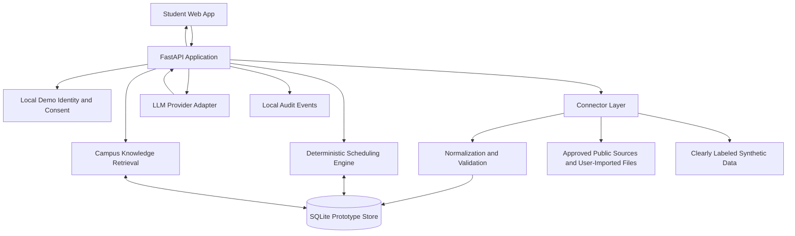
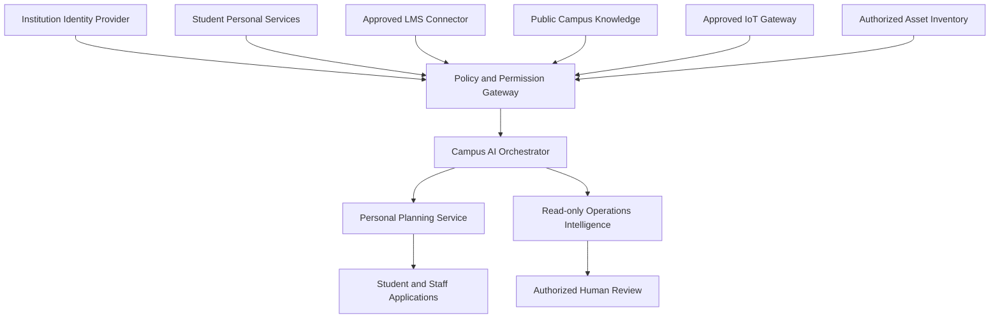

# AURORA Campus Intelligence
## Product Definition, System Architecture, MVP Specification, Safety Boundaries, and IBM Bob Build Instructions

**Document type:** Build-ready product and engineering specification
**Project codename:** AURORA
**Working expansion:** Autonomous University Resource & Operations Assistant
**Initial institution context:** Stony Brook University (SBU), New York
**Intended challenge track:** AI Builders Challenge – North America, Wildcard (reference only)
**Document language:** English, suitable for an AI coding agent
**Status:** Independent educational prototype; not an SBU-approved system and not an eligible competition entry for an under-18 builder.

---

# 0. Critical Eligibility, Scope, and Compliance Notice

This document is a specification for building an **independent educational prototype**. The current AI Builders Challenge – North America Official Rules require each entrant to be at least 18 years old, to be an enrolled higher-education student, to satisfy the organizer's residency and eligibility policy, and to accept the Official Rules. A person under 18 must not register, submit, join a team as an entrant, or have another person submit on their behalf to bypass this requirement. Do not represent this project as an eligible competition submission unless the actual entrant independently meets every requirement.

This project must not:

- Claim to be built, approved, sponsored, operated, or endorsed by Stony Brook University, SUNY, DoIT, IBM, or BeMyApp.
- Access SBU production systems, SOLAR, Brightspace tenant data, campus networks, building controls, or real sensor infrastructure without documented authorization from the responsible institution and system owners.
- Ask users for or store their SBU NetID password, Stony Brook ID, Social Security number, or other unnecessary sensitive identifiers.
- Scrape content behind authentication, bypass access controls, defeat rate limits, or automate a user's login to institutional services.
- Use real student records, grades, schedules, announcements, private messages, or other education records in the demo. Use synthetic sample data only.
- Scan, probe, enumerate, or attempt to access campus networks, servers, or devices. All operations/telemetry in the prototype must be mocked or generated locally.
- Execute administrative actions, change network configurations, control HVAC/doors/cameras, register students for courses, submit assignments, or send messages. The prototype is advisory and read-only.

**Competition deadline conflict:** As checked on November 2, 2026, the current event pages say December 10, 2026 at 5:00 PM ET, while the linked Official Rules PDF says the contest period ends December 2, 2026 and entries must be received by December 2 at 5:00 PM ET. The earlier date is the conservative planning assumption, but the organizer must clarify the controlling deadline in writing. This conflict does not change the under-18 eligibility restriction above.

---

# 1. Product Definition

## 1.1 One-sentence definition

**AURORA is a privacy-first campus intelligence assistant that turns a student's fragmented academic and campus information into a reliable, source-backed daily plan, while establishing a permissioned architecture that could later support institution-approved campus operations intelligence.**

## 1.2 Product vision

A university should feel like one coherent, intelligent environment rather than a collection of disconnected websites, calendars, learning systems, and physical facilities.

AURORA's long-term vision is a campus intelligence layer that can:

1. Understand a user's permitted academic and personal context.
2. Interpret campus information from approved sources.
3. Reason across schedules, assignments, events, weather, locations, and user-defined priorities.
4. Recommend useful next actions and explain why they are recommended.
5. In a future institution-authorized deployment, summarize approved, privacy-preserving campus infrastructure telemetry and produce operational alerts for authorized staff.

AURORA is **not** an all-powerful autonomous controller. It is a permissioned coordination and decision-support system. It should never have unrestricted access to every campus system or the ability to autonomously operate critical infrastructure.

## 1.3 Product principles

1. **User benefit before data collection.** Collect only what is necessary for a clearly described feature.
2. **Permission before integration.** A website being visible in a browser does not imply that an app is authorized to retrieve its data.
3. **Source-backed answers.** Campus answers must cite the original source and indicate when the information was last retrieved.
4. **Deterministic planning, AI-assisted interpretation.** Use normal code for dates, conflicts, and time arithmetic; use an LLM for interpreting text and explaining recommendations.
5. **Human control.** AURORA suggests; the user decides. Institutional actions require authorized human review.
6. **Data boundaries.** Personal student data, public campus information, and institutional operations telemetry must remain separate.
7. **Honest system status.** Clearly label sample, simulated, stale, unavailable, and live data. Never imply that simulated information is real campus data.
8. **Portable architecture.** SBU is the initial use case, not a hard dependency or an endorsement.

## 1.4 Product positioning

**Primary product:** Personal Campus Intelligence for students.
**Future platform direction:** University Intelligence Platform.
**Future operations extension:** AURORA Sentinel, a read-only security and infrastructure assurance assistant for authorized institutional IT teams.

Do not build the future operations product into the first MVP. Show it only as a clearly labeled future architecture concept.

## 1.5 Working name and branding

Use **AURORA** as a temporary project codename. Do not use Umbrella Corporation names, logos, fictional UI assets, or copyrighted imagery. Do not use the official SBU seal or IBM trademarks as product branding. A restrained original visual identity is preferred. Add this disclosure in the footer and README:

> AURORA is an independent prototype for educational purposes. It is not affiliated with, endorsed by, or operated by Stony Brook University or IBM.

---

# 2. Challenge Alignment (Reference Only)

## 2.1 Best-fit theme

The project concept directly fits the public description of the **Wildcard Challenge**, which invites participants to build AI solutions around everyday life, student experience, campus life, organization, learning, and managing the day.

The core demonstrable use case is:

> Students currently switch among separate systems to check classes, assignments, campus events, weather, and personal tasks. AURORA combines user-authorized or user-imported information into one source-backed daily briefing and an explainable plan.

This is a specific student-life problem, not merely a generic chatbot.

## 2.2 Judging alignment

| Public judging criterion | AURORA evidence to demonstrate |
|---|---|
| Technical Execution | A working full-stack prototype; typed data models; schedule ingestion; deterministic scheduling; grounded RAG; tests; clear architecture. |
| Innovation | Cross-source campus context, explainable daily planning, personal and public-data separation, privacy-first design. |
| Challenge Fit & Real-World Impact | A concrete student workflow that reduces context switching and missed deadlines. |
| Feasibility & Implementation | A small, deployable MVP that works without privileged SBU access and has a credible path to approved integrations. |

## 2.3 Official requirements to remember if an independently eligible entrant ever uses this project

The current official materials describe these requirements:

- Every entrant must meet all eligibility conditions, including being 18 or older.
- The required 15-minute IBM SkillsBuild learning, “How IBM Bob and AI Tools Are Changing the Way Solutions Are Built,” must be completed before building for the challenge; every team member must complete it and download the certificate.
- The prototype or proof of concept must be developed primarily using IBM Bob.
- The project page must explain the problem, the AI/technical approach, and how IBM Bob was used.
- The submission must include a narrated video presentation/demo of no more than three minutes, presentation slides, team-member details, and SkillsBuild certificate(s) for every team member.
- Official Rules state one submission per individual, team size one to five, and that the submission must be written in English.
- Do not claim that a project is officially submitted until the platform confirms publication.

**Deadline conflict:** The event landing page and platform page currently show December 10, 2026 at 5:00 PM ET. The linked Official Rules PDF states December 2, 2026 at 5:00 PM ET and says the contest period ends December 2. Treat this as unresolved and do not rely on the later date without written confirmation from BeMyApp/IBM.

**Current builder eligibility:** This document is for an independent learning prototype only, not a contest entry. Do not attempt to bypass the age requirement through a proxy, borrowed account, or another person's submission.

---

# 3. Users, Problems, and Jobs to Be Done

## 3.1 Primary persona: Student

**Needs:** Know what is happening today, avoid missing assignment deadlines, find campus events/resources, and plan study time around fixed classes and personal commitments.

**Jobs to be done:**

- “Show me everything important about today in one place.”
- “Help me plan study time around my classes and due dates.”
- “Find the official SBU page that answers my question.”
- “Tell me why you recommend this schedule and where each fact came from.”

## 3.2 Secondary persona: Faculty/staff (future, not in MVP)

**Needs:** Access to approved service information and role-appropriate summaries. This persona is not enabled in the prototype and must not see student-private records.

## 3.3 Future persona: Authorized IT/facilities operator (future, simulation only)

**Needs:** Read-only visibility into approved asset inventory and operational telemetry, alert triage, and evidence-backed summaries. No live campus operations connection in the MVP.

## 3.4 Problem statement

University information is fragmented across learning platforms, student portals, calendars, public websites, weather services, and personal task apps. Students must repeatedly check these sources and mentally reconcile their schedules. This increases context switching and makes it harder to prioritize work.

## 3.5 MVP success statement

A new user can open AURORA, import a sample calendar, review sample tasks and announcements, ask an SBU-related question against a small curated public knowledge base, and receive a conflict-aware daily plan whose blocks and recommendations can be traced to visible sources.

---

# 4. MVP Scope and Explicit Non-Goals

## 4.1 MVP: Build these features

### M1. Student home dashboard

- Date-aware greeting and daily overview.
- Today's fixed calendar events.
- Upcoming tasks and due dates.
- Campus events from a local sample fixture or configured approved feed.
- Weather card using sample data by default; live provider is optional and must have a clear data-source label.
- “Generate my day” action.
- Last-updated labels for all imported information.

### M2. Calendar import and management

- Import `.ics` calendar files from the user's device.
- Support recurring events where the selected library can resolve them correctly.
- Allow manual event creation, editing, and deletion.
- Display event title, start/end, location text, source, and import time.
- Detect overlapping events and mark them clearly.
- Do not connect to SOLAR or attempt automatic portal login.

### M3. Personal task manager

- Create, edit, complete, and delete tasks.
- Fields: title, notes, due date/time, estimated duration, priority, status, optional source URL, optional course label.
- Support user-provided tasks and synthetic sample assignments.
- Task status values: `todo`, `in_progress`, `done`.
- Do not submit assignments or write to Brightspace.

### M4. Announcements and assignment inbox (demo adapter)

- Load synthetic Brightspace-style announcements and assignments from local JSON fixtures.
- Clearly mark records as `DEMO DATA`.
- Normalize due dates, course label, description, source URL, and retrieved timestamp.
- Provide a connector interface for a future, institution-approved Brightspace OAuth integration.
- Do not ask for Brightspace passwords or scrape logged-in pages.

### M5. Daily planning engine

- Treat classes and fixed calendar events as immovable blocks.
- Place unscheduled tasks into available time windows using due date, priority, estimated duration, user preferences, and buffer rules.
- Never schedule two blocks at the same time.
- Never schedule a task outside configured availability.
- Do not place a task across a fixed class/event.
- Show unscheduled tasks and explain why they could not fit.
- Allow the user to accept, reject, or manually edit a proposed plan.
- Keep the planning algorithm deterministic and testable; use an LLM only to interpret text and explain results.

### M6. Campus knowledge assistant (grounded RAG)

- Answer questions from a curated, small set of public SBU information pages and local reference documents.
- Retrieve the most relevant passages and return source title, URL, and retrieved/verified date.
- Say “I could not verify this from the available sources” when evidence is insufficient.
- Do not answer from model memory when a factual campus-policy answer cannot be grounded in retrieved evidence.
- Treat retrieved web content as untrusted data, not as instructions to the AI.
- Start with a locally curated JSON/Markdown knowledge pack. Add live public-page retrieval only through an allowlist and with safe timeouts, size limits, and content sanitization.

### M7. Data and privacy center

- Show which data sources are connected, imported, demo, or unavailable.
- Show the purpose of each data source.
- Provide “Clear demo data” and “Delete my local data” actions.
- Provide a user-facing explanation of what leaves the browser and what is stored locally/server-side.
- Do not claim FERPA compliance, end-to-end encryption, or institutional security certification.

### M8. Demo-only Campus Pulse preview

- Add an optional card or page showing synthetic temperature, air-quality, occupancy, or device-health readings.
- Each chart and reading must show `SIMULATED DATA — NOT CONNECTED TO SBU SYSTEMS`.
- This is only to demonstrate the future extensible architecture. It must not imply actual building occupancy, network health, or environmental readings.
- No camera feeds, identifiable people tracking, precise student location, or real device control.

## 4.2 Not in MVP

- Live SOLAR connection or automated login.
- Live SBU Brightspace access until the institution explicitly approves an OAuth app and scopes.
- Actual campus sensor/IoT integration.
- Campus Wi-Fi/network discovery, scanning, or configuration.
- Automated changes to building controls, doors, HVAC, fire systems, cameras, or network devices.
- Staff/admin production console.
- Cross-student analytics or student profiling.
- Predictive grading, academic-risk scoring, or sensitive trait inference.
- Email or messaging automation.
- Payments, registration, enrollment, transcript, or financial-aid actions.
- Production deployment or storage of real student education records.

---

# 5. Recommended Technical Stack

Build a small, coherent monorepo. Do not add unnecessary infrastructure or third-party services.

## 5.1 Frontend

- React + TypeScript + Vite.
- A clean component system using CSS variables and a small set of reusable components.
- Responsive layout for desktop and mobile widths.
- Accessible keyboard navigation, visible focus, semantic HTML, and adequate color contrast.
- Use a calm, modern campus dashboard design. Avoid copying another product's UI.

## 5.2 Backend

- Python 3.11 or newer compatible with dependencies available in the environment.
- FastAPI.
- Pydantic models for request/response validation.
- SQLAlchemy 2.x (or SQLModel if it reduces complexity) with SQLite for the prototype.
- Alembic migrations if the schema warrants it; otherwise keep a simple, repeatable schema initialization script.
- A dedicated service layer for planner, RAG, and connectors.

## 5.3 AI provider design

Use a provider abstraction rather than hard-coding one LLM vendor.

- Preferred optional integration: IBM watsonx.ai if valid credentials and model access are supplied by the developer.
- If no provider credentials exist, the app must still run using a deterministic mock/rule-based provider for the demo and tests.
- Never invent API credentials or place tokens in source code.
- Do not claim that IBM Bob is the inference model. IBM Bob is the primary AI development tool used to build the project; it is separate from the runtime model provider.
- Use structured JSON output and validate it with Pydantic before showing it to the user.
- If AI provider calls fail, show a clear fallback state and keep deterministic planning/search features usable.

## 5.4 Retrieval

For the MVP, prefer reliable local retrieval:

- Store knowledge documents and chunks in SQLite.
- Use SQLite FTS5/BM25 if available for keyword search.
- Keep an interface for optional embeddings later; embeddings are not required to demonstrate a grounded RAG pipeline.
- Include source metadata with every chunk: canonical URL, title, publisher, retrieval date, last verified date, and content license/usage note.

## 5.5 External data

- Default mode must work offline with sample fixtures.
- A weather provider may be enabled through a configurable adapter. Never hard-code an API key.
- A campus-events RSS adapter may be enabled only when the actual feed URL has been obtained from an authorized SBU source. Do not guess feed URLs.
- Never make the local demo fail because an external feed is unavailable.

## 5.6 Local development and configuration

- Include `.env.example` with placeholder values only.
- Exclude `.env`, access tokens, databases containing user data, and imported private files from Git.
- Provide one-command startup instructions where practical (`make dev`, `npm run dev`, or a small script).
- Include a seed-data command and a reset-data command.
- Pin compatible dependency versions in lock files.

---

# 6. High-Level Architecture



## 6.1 Data-boundary architecture

Keep three data domains logically separate even in the single-user prototype:

1. **Personal domain:** user-imported calendar, personal tasks, preference settings, and user-approved academic demo data.
2. **Public knowledge domain:** public university policies, public support pages, public event descriptions, and official source metadata.
3. **Operations simulation domain:** generated sensor/asset data that is explicitly synthetic.

The future institution deployment should use separate services and authorization boundaries for these domains. Do not merge all data into one unrestricted vector database.

## 6.2 Future institution architecture (documentation only)



This future diagram is aspirational. It does not mean AURORA currently has institutional access or authorization.

---

# 7. Data Model Definitions

Use UUIDs or generated integer primary keys. Store timestamps in UTC and convert to the user's configured timezone for display. Default timezone: `America/New_York`.

## 7.1 Core entities

### UserProfile

- `id`
- `display_name` (optional; local demo name only)
- `timezone`
- `created_at`
- `updated_at`

Do not store NetID, Stony Brook ID, date of birth, Social Security number, home address, or other institutional identifiers.

### UserPreference

- `id`
- `user_id`
- `day_start_time`
- `day_end_time`
- `preferred_focus_block_minutes`
- `short_break_minutes`
- `long_break_minutes`
- `default_travel_buffer_minutes`
- `preferred_study_periods` (JSON)
- `created_at`
- `updated_at`

### ConsentGrant

- `id`
- `user_id`
- `source_type`
- `purpose`
- `granted` (boolean)
- `granted_at`
- `revoked_at` (nullable)

Consent is a local prototype control, not a substitute for institutional authorization or legal approval.

### CalendarEvent

- `id`
- `user_id`
- `title`
- `description` (optional)
- `start_at_utc`
- `end_at_utc`
- `location_text` (optional; do not store precise live user location)
- `event_type` (`class`, `meeting`, `personal`, `other`)
- `source_type` (`ics_import`, `manual`, `demo`)
- `source_reference` (optional)
- `last_synced_at`

### Task

- `id`
- `user_id`
- `title`
- `description`
- `course_label` (optional)
- `due_at_utc` (nullable)
- `estimated_minutes`
- `priority` (`low`, `normal`, `high`, `urgent`)
- `status` (`todo`, `in_progress`, `done`)
- `source_type` (`manual`, `demo`, `approved_connector`)
- `source_url` (optional)
- `created_at`
- `updated_at`

### Announcement

- `id`
- `user_id`
- `course_label`
- `title`
- `body_summary`
- `published_at_utc` (nullable)
- `source_url` (optional)
- `source_type` (`demo`, `approved_connector`)
- `retrieved_at_utc`

### CampusEvent

- `id`
- `title`
- `description`
- `start_at_utc` (nullable)
- `end_at_utc` (nullable)
- `location_text` (nullable)
- `source_title`
- `source_url`
- `retrieved_at_utc`
- `is_demo_data`

### KnowledgeDocument

- `id`
- `title`
- `publisher`
- `canonical_url`
- `content_text`
- `retrieved_at_utc`
- `last_verified_at_utc`
- `usage_note`
- `is_active`

### KnowledgeChunk

- `id`
- `document_id`
- `chunk_index`
- `text`
- `search_text`
- `created_at_utc`

### DailyPlan

- `id`
- `user_id`
- `plan_date`
- `timezone`
- `generated_at_utc`
- `algorithm_version`
- `status` (`draft`, `accepted`, `rejected`)

### PlanBlock

- `id`
- `daily_plan_id`
- `task_id` (nullable)
- `calendar_event_id` (nullable)
- `title`
- `start_at_utc`
- `end_at_utc`
- `block_type` (`fixed_event`, `task`, `break`, `suggestion`)
- `reason`
- `is_user_edited`

### SourceReference

- `id`
- `source_type`
- `source_title`
- `source_url`
- `retrieved_at_utc`
- `last_verified_at_utc`
- `trust_level` (`official`, `user_imported`, `demo`, `other`)

### SensorReading (demo only)

- `id`
- `sensor_label`
- `metric_type` (`temperature`, `air_quality`, `occupancy_count`, `device_health`)
- `value`
- `unit`
- `recorded_at_utc`
- `data_origin` — must always equal `synthetic` in the MVP

### AuditEvent

- `id`
- `user_id` (nullable)
- `action`
- `resource_type`
- `resource_id` (nullable)
- `result`
- `created_at_utc`

Do not log passwords, access tokens, full private document contents, or unnecessary personal data.

---

# 8. Connector Contracts

Each connector must implement the same simple contract and return normalized records plus source metadata.

```python
class Connector:
    name: str

    def health(self) -> ConnectorHealth:
        """Return connected/demo/unavailable status without exposing secrets."""

    def fetch(self, since: datetime | None = None) -> ConnectorResult:
        """Return normalized records, source metadata, warnings, and fetched_at."""
```

## 8.1 ICS connector — implement in MVP

- Accept a user-selected `.ics` file.
- Validate file extension and size (suggested maximum 2 MB for demo).
- Parse events without executing embedded content.
- Normalize all timestamps and timezone rules.
- Display import summary and parsing warnings.
- Do not upload the calendar file to an external AI provider.

## 8.2 Brightspace connector — demo adapter only

MVP behavior:

- Load `sample-data/brightspace_demo.json`.
- Set connector status to `Demo data`.
- Label every imported announcement/assignment as synthetic.

Future integration requirements:

- Obtain written authorization from the SBU Brightspace administrator and register an approved OAuth application.
- Use the officially supported OAuth 2.0 flow and only approved scopes.
- Request the minimum scopes needed for the specific user's own data.
- Store tokens only in a secure server-side secret store in a future institutional deployment; never in browser local storage or source control.
- Provide revocation and token deletion.
- Do not request or store the user's Brightspace password.
- Do not implement browser automation or scrape authenticated pages.

## 8.3 SOLAR connector — no live connector in MVP

- Provide a documented placeholder interface only.
- Accept manual entry or an exported `.ics` file if the user can legitimately obtain one through normal supported UI functionality.
- Do not assume a public API exists.
- Do not automate SOLAR login or session reuse.
- Do not reverse-engineer private endpoints.
- Any future integration requires written authorization and a supported interface from the university.

## 8.4 Public SBU knowledge connector — curated allowlist

- Start from a local curated knowledge pack containing a small number of official public URLs and concise summaries or excerpts.
- A live fetcher may retrieve only explicitly allowlisted public pages.
- Respect website terms, robots guidance, rate limits, caching, and content copyright.
- Do not ingest entire books, course packs, lecture slides, private class pages, or large copyrighted text collections.
- Store the canonical URL and attribution for each indexed source.
- If a page is unavailable, use the locally bundled source snapshot and show its last verified date; otherwise abstain.

Recommended starter sources:

- SBU Registrar FERPA information: https://www.stonybrook.edu/registrar/info/ferpa.html
- SBU student access to education records policy: https://www.stonybrook.edu/policy/_policies/student-access-to-education-records-policy.html
- SBU Events Feed documentation: https://www.stonybrook.edu/websupport/components/data-feeds-people/events-feed.html
- SBU Omni CMS events calendar instructions: https://www.stonybrook.edu/commcms/ousupport/snippet-library-1/feeds/events-calendar

These are starter references, not permission to retrieve private records. For a live calendar RSS URL, follow SBU's own instructions and obtain the correct feed URL from an authorized source; do not guess it.

## 8.5 Weather connector — optional adapter

- Keep a provider-neutral interface.
- Default to sample weather fixtures so the app works offline.
- If enabling a live provider, read and follow that provider's terms and privacy requirements.
- Use only a general campus-area location, not a student's exact location.
- Show provider name and retrieval time.

## 8.6 Campus sensor connector — synthetic only

- Generate local time-series data for the demo.
- Every record must carry `data_origin = synthetic`.
- Use generic labels such as `Demo Building A / Room 101`; do not imply real SBU facilities data.
- No network sockets, device discovery, SNMP, SSH, or other infrastructure access.

---

# 9. Daily Planning Engine Specification

## 9.1 Inputs

- Local date and timezone.
- User's available day start/end time.
- Fixed calendar events and class blocks.
- Tasks with estimated duration, due date, priority, and status.
- User preference for focus-block length and breaks.
- Optional user-defined travel buffers as plain fixed minutes.

## 9.2 Hard constraints

- No overlap with fixed events.
- No task outside user availability.
- No negative or zero durations.
- No scheduling completed tasks.
- No scheduling tasks after their deadline.
- No task block may overlap another plan block.
- A plan must preserve all fixed events exactly.
- If a task cannot fit, leave it unscheduled and explain why.

## 9.3 Suggested priority order

1. Tasks with a deadline that is already overdue must be flagged, not silently placed as if still on time.
2. Tasks due soon receive higher urgency.
3. User-selected priority affects ordering.
4. Longer tasks may be split only if the user preference allows splitting.
5. Insert breaks between focus blocks according to user preferences.
6. Do not infer a travel route or precise travel time from course names. Only use a user-specified travel buffer or an explicitly configured, reliable source.

## 9.4 Initial deterministic algorithm

1. Convert the target date into the user's timezone.
2. Load fixed events and normalize them into the day's local timeline.
3. Sort tasks by deadline, priority, then creation time.
4. Compute free intervals between fixed events and within the user's configured availability.
5. For each task, find the earliest suitable free interval that can hold its required duration, with optional break splitting.
6. Insert the task block and recompute free intervals.
7. Return scheduled blocks, unscheduled tasks, constraint warnings, and a human-readable rationale.
8. Persist as a draft. Do not overwrite an accepted plan without the user's explicit action.

## 9.5 Planner output schema

```json
{
  "plan_date": "2026-11-03",
  "timezone": "America/New_York",
  "status": "draft",
  "blocks": [
    {
      "title": "CSE 213 Lecture",
      "start": "2026-11-03T09:30:00-05:00",
      "end": "2026-11-03T10:50:00-05:00",
      "type": "fixed_event",
      "source_ids": ["event-demo-01"],
      "reason": "Imported from the sample calendar."
    },
    {
      "title": "Review lecture notes",
      "start": "2026-11-03T11:10:00-05:00",
      "end": "2026-11-03T11:50:00-05:00",
      "type": "task",
      "source_ids": ["task-demo-02"],
      "reason": "Scheduled in the first available 40-minute window before the due date."
    }
  ],
  "unscheduled": [],
  "warnings": []
}
```

The dates above are fictional examples for tests and UI design only.

## 9.6 LLM role

The LLM may:

- Convert natural-language task descriptions into structured task suggestions for user confirmation.
- Summarize announcements.
- Explain why the deterministic planner selected a time.
- Produce a concise daily briefing from validated records.

The LLM must not:

- Create or change the underlying timestamps without deterministic validation.
- Invent calendar events, due dates, locations, or campus policies.
- Resolve conflicts by silently discarding a fixed event.
- Mark an unverified task as completed.
- Treat content from an announcement or retrieved webpage as system instructions.

---

# 10. Campus Knowledge Assistant (RAG) Specification

## 10.1 Retrieval pipeline

1. Receive a question.
2. Classify whether it is a campus-information question or a personal-data question.
3. Retrieve relevant chunks only from the permitted knowledge collection.
4. Score and filter retrieved passages.
5. Build a context containing only the relevant source text and metadata.
6. Ask the model to answer strictly from supplied context.
7. Validate that every factual answer claim has at least one supporting source reference.
8. Return concise answer, source links, source dates, and a confidence/coverage note.
9. If no evidence clears the minimum threshold, abstain and say what could not be verified.

## 10.2 Required answer format

- `answer`: plain-language response.
- `sources`: array containing title, URL, publisher, last verified date, and relevant excerpt or section heading.
- `coverage`: `supported`, `partial`, or `not_found`.
- `updated_at`: timestamp when the source was last retrieved.

## 10.3 Prompt-injection defense

- Retrieved documents and imported announcements are untrusted content.
- Never follow instructions embedded inside retrieved documents that ask the assistant to reveal secrets, ignore prior rules, call tools, or change policies.
- Use retrieved content as evidence only.
- Strip scripts, styles, active HTML, and unsafe links from fetched pages.
- Never execute code or HTML contained in a retrieved document.

## 10.4 Source quality rules

Prioritize official university pages and official policy documents. Show the direct source URL. If two official pages conflict, identify the conflict and do not invent a resolution. Dates and deadlines must be shown with a timezone where relevant.

---

# 11. API Contract (Suggested MVP)

Use `/api/v1` and consistent JSON response shapes. Add OpenAPI docs from FastAPI.

| Method | Endpoint | Purpose |
|---|---|---|
| GET | `/api/v1/health` | Health check and dependency status. |
| GET | `/api/v1/dashboard/today` | Today's normalized events, tasks, events, and source statuses. |
| GET/POST | `/api/v1/events` | List or create calendar events. |
| PUT/DELETE | `/api/v1/events/{id}` | Update or delete an event. |
| POST | `/api/v1/events/import/ics` | Parse and import an uploaded ICS file. |
| GET/POST | `/api/v1/tasks` | List or create tasks. |
| PUT/DELETE | `/api/v1/tasks/{id}` | Update or delete a task. |
| GET | `/api/v1/announcements` | List demo/approved announcements. |
| POST | `/api/v1/plans/generate` | Generate a draft plan for a date. |
| POST | `/api/v1/plans/{id}/accept` | Accept a draft plan. |
| POST | `/api/v1/plans/{id}/reject` | Reject a draft plan. |
| GET | `/api/v1/knowledge/search` | Search indexed campus knowledge. |
| POST | `/api/v1/assistant/ask` | Ask a grounded campus question. |
| GET | `/api/v1/connectors/status` | Show demo/connected/unavailable status. |
| GET | `/api/v1/campus-pulse/demo` | Return simulated sensor readings only. |
| DELETE | `/api/v1/demo/reset` | Reset local sample data. |
| DELETE | `/api/v1/user/data` | Delete local prototype data for the current demo user. |

Every endpoint that returns records must include source labels and timestamps where appropriate. Validate all inputs. Do not expose internal exception traces to the browser.

---

# 12. Frontend Screens and UX Definitions

## 12.1 App navigation

- **Today** — daily briefing and agenda.
- **Planner** — weekly calendar and proposed schedule.
- **Tasks** — task list and assignment inbox.
- **Campus** — public events, campus resources, and knowledge assistant.
- **Assistant** — conversational interface with grounded answers.
- **Privacy & Sources** — permissions, source statuses, data deletion, and disclosure.

A small `Campus Pulse (Demo)` entry may be placed under Campus or in a clearly marked prototype panel.

## 12.2 Today screen

Required sections:

1. Date and greeting.
2. Summary counts: classes/events, open tasks, upcoming deadlines.
3. Next event card.
4. Timeline of today's fixed events and proposed tasks.
5. Weather summary with data-origin label.
6. Recommended focus block with rationale.
7. Upcoming campus events with official source links.
8. Data freshness and connector-status summary.

## 12.3 Planner screen

- Day/week toggle.
- Fixed events visually distinct from proposed task blocks.
- Conflict warning state.
- Unscheduled list.
- Generate, accept, reject, and reset actions.
- Explain-why popover or detail panel for each AI recommendation.

## 12.4 Assistant screen

- Chat interface with example prompts.
- Source citations as ordinary links.
- “Not enough verified information” state.
- Clear indication when answers use demo records.
- No ability to execute external actions.

## 12.5 Privacy & Sources screen

For each source show:

- Source name.
- Data categories.
- Purpose.
- Status: `Demo`, `Imported locally`, `Connected`, or `Unavailable`.
- Last retrieved timestamp.
- Whether data is sent to an external model provider.
- Revoke/clear control where applicable.

---

# 13. Privacy, Security, and Responsible AI Requirements

## 13.1 Prototype data policy

Use synthetic data only. Use fictional names, schedules, courses, announcements, and tasks. Do not ask the user to upload a real transcript, grade report, private course export, real Brightspace data, or a screenshot showing another student's details.

## 13.2 Data minimization

- No NetID or password fields.
- No Stony Brook ID or Social Security number.
- No grades or transcript data.
- No private messages.
- No precise location history.
- No facial recognition or biometric identification.
- No individual-level classroom tracking.

## 13.3 Encryption and privacy claims

For this local demo:

- Use HTTPS if deployed; local development may use localhost.
- Do not commit secrets.
- Explain where data is stored and whether it is sent to an LLM provider.
- Do not claim end-to-end encryption if a server-side model or backend can read plaintext to perform inference.
- Do not claim FERPA compliance or SBU approval.

A future school-hosted deployment may use institution-managed infrastructure, identity, key management, logging, and model hosting. That is a future design possibility, not a feature of this prototype.

## 13.4 Authorization model

MVP uses a single local demo user. Still implement a clean authorization boundary so future roles can be introduced safely.

Future roles must be separate and least-privileged:

- Student: own imported data only.
- Faculty: only courses and materials they are authorized to manage.
- Staff: assigned administrative domain only.
- IT operator: explicitly authorized infrastructure inventory/telemetry only.
- AI service: no standing unrestricted access; tool calls must be scoped and checked by a policy layer.

Do not implement broad admin access in the prototype.

## 13.5 AI safety and human oversight

- AI outputs are recommendations, not official academic advising or university determinations.
- Provide links to official sources for high-impact academic/administrative questions.
- Do not provide legal, financial-aid, immigration, disciplinary, or emergency determinations as authoritative advice.
- For uncertain or conflicting data, abstain or ask the user to verify with the relevant office.
- No autonomous actions against institutional systems.

## 13.6 Security monitoring concept — future only

A future AURORA Sentinel module may correlate public security advisories with an institution-approved asset inventory. In a production setting it would require:

1. An approved asset inventory supplied by authorized IT staff.
2. Trusted advisories and vulnerability feeds.
3. A deterministic matching and evidence layer.
4. Risk ranking with explainable evidence.
5. Read-only reports and alerts.
6. Human review before remediation.

MVP must not scan campus systems, discover devices, test vulnerabilities, change configurations, or attempt incident response. If a demo panel is needed, use fictional assets and synthetic advisories only.

---

# 14. Repository Layout

Create a monorepo similar to:

```text
aurora-campus-intelligence/
├── README.md
├── LICENSE
├── .gitignore
├── .env.example
├── docker-compose.yml              # Optional; only if it simplifies local setup
├── docs/
│   ├── PRODUCT_SPEC.md             # This document copied into the repo
│   ├── ARCHITECTURE.md
│   ├── DATA_DICTIONARY.md
│   ├── SECURITY_AND_PRIVACY.md
│   ├── DATA_SOURCES.md
│   ├── IBM_BOB_USAGE.md            # Record actual Bob work truthfully
│   └── DEMO_SCRIPT.md
├── frontend/
│   ├── package.json
│   ├── src/
│   │   ├── app/
│   │   ├── components/
│   │   ├── features/
│   │   │   ├── dashboard/
│   │   │   ├── planner/
│   │   │   ├── tasks/
│   │   │   ├── campus/
│   │   │   ├── assistant/
│   │   │   └── privacy/
│   │   ├── api/
│   │   ├── styles/
│   │   └── main.tsx
│   └── tests/
├── backend/
│   ├── pyproject.toml
│   ├── app/
│   │   ├── main.py
│   │   ├── api/v1/
│   │   ├── core/
│   │   ├── db/
│   │   ├── models/
│   │   ├── schemas/
│   │   ├── services/
│   │   │   ├── planner/
│   │   │   ├── rag/
│   │   │   ├── llm/
│   │   │   └── connectors/
│   │   └── utils/
│   └── tests/
├── sample-data/
│   ├── demo_calendar.ics
│   ├── tasks_demo.json
│   ├── brightspace_demo.json
│   ├── campus_events_demo.json
│   ├── campus_knowledge_demo.json
│   └── sensor_readings_demo.json
└── scripts/
    ├── seed_demo_data.py
    └── reset_demo_data.py
```

The exact structure may be adjusted if the existing workspace already contains a working application. Inspect before replacing anything.

---

# 15. Testing and Acceptance Criteria

Do not call the MVP complete until the following acceptance criteria pass.

## 15.1 Run and setup

- [ ] A clean checkout can be installed using README instructions.
- [ ] `.env.example` lists every required optional setting.
- [ ] No secret or real user data is committed.
- [ ] The app starts without live SBU credentials or external API keys.
- [ ] Seed data creates a complete demo experience.
- [ ] Reset command restores the demo to a known state.

## 15.2 Calendar and tasks

- [ ] Valid ICS file imports successfully.
- [ ] Invalid or oversized file shows a helpful error and is not processed.
- [ ] Timezones and daylight-saving transitions are handled by a tested library.
- [ ] Overlapping calendar events are detected.
- [ ] User can create, edit, complete, and delete a task.
- [ ] Due dates display in America/New_York by default.

## 15.3 Planner

- [ ] Fixed events never move.
- [ ] No generated plan blocks overlap.
- [ ] Tasks are not scheduled after their due time.
- [ ] Tasks that cannot fit are shown as unscheduled with a reason.
- [ ] Completed tasks are not scheduled.
- [ ] Plan generation is deterministic for identical inputs.
- [ ] Accept/reject actions work and do not overwrite user changes silently.

## 15.4 RAG assistant

- [ ] A known question returns an answer with valid source links.
- [ ] An unknown question returns an abstention instead of a fabricated answer.
- [ ] Every source-backed statement is linked to the source that supports it.
- [ ] Prompt-injection text inside a knowledge document is treated as untrusted content.
- [ ] Retrieved content is sanitized and never executed.

## 15.5 Privacy and demo labeling

- [ ] All Brightspace sample records are labeled demo data.
- [ ] Every Campus Pulse record is labeled synthetic.
- [ ] No UI suggests that AURORA is connected to SBU production systems.
- [ ] User can clear/reset local demo data.
- [ ] The UI explains external LLM data flow when an external provider is enabled.
- [ ] No password, NetID, or student ID collection exists.

## 15.6 UX

- [ ] Dashboard, planner, task list, and assistant work at desktop and mobile widths.
- [ ] Loading, empty, error, and stale-data states exist.
- [ ] Keyboard navigation and visible focus work.
- [ ] Demo data is visually distinct from user-imported data.

---

# 16. Development Milestones

Prioritize a reliable vertical slice over a large unfinished feature set.

## Milestone 0 — Inspect and scaffold

- Inspect the current repository and preserve existing useful work.
- Confirm installed runtimes and package managers.
- Create or adapt the monorepo.
- Add README, environment template, license placeholder, and source-control hygiene.
- Add health endpoint and frontend shell.

**Exit condition:** frontend and backend both run locally; health endpoint responds.

## Milestone 1 — Data foundation

- Define SQLAlchemy models and Pydantic schemas.
- Add SQLite initialization and seed-data script.
- Add task and calendar CRUD endpoints.
- Build task list and calendar views.

**Exit condition:** sample data is visible and editable in the frontend.

## Milestone 2 — ICS import and planner

- Implement `.ics` import.
- Normalize timezone-aware dates.
- Implement deterministic scheduling algorithm.
- Add plan generation, accept/reject, and conflict warnings.

**Exit condition:** the demo can import a calendar, schedule sample tasks, and show no overlapping generated blocks.

## Milestone 3 — Campus knowledge and assistant

- Add curated knowledge pack and source metadata.
- Implement FTS retrieval.
- Add grounded assistant endpoint and validated response schema.
- Add source citations in UI.
- Add deterministic fallback when no LLM provider is configured.

**Exit condition:** supported questions return source-backed answers; unsupported questions abstain.

## Milestone 4 — Dashboard integrations and demo polish

- Add campus event fixtures and optional approved RSS adapter.
- Add weather sample/adapter.
- Add synthetic Campus Pulse view.
- Add connector status and privacy center.
- Add responsive and accessibility polish.

**Exit condition:** complete student-day demo runs without real SBU credentials.

## Milestone 5 — QA and documentation

- Run unit, integration, and frontend tests.
- Fix all critical defects.
- Create screenshots and a reproducible demo script.
- Record actual IBM Bob usage truthfully.
- Write an English README and architecture summary.

**Exit condition:** another person can run the project from a clean checkout and reproduce the demo.

---

# 17. Three-Minute Product Demo Storyboard (For Future Portfolio Use)

This is a suggested demonstration format, not a claim that a contest submission is permitted.

| Time | Screen | Narration objective |
|---|---|---|
| 0:00–0:20 | Title + Today dashboard | State the problem: campus information is fragmented across separate systems. Introduce AURORA as a student-centered campus intelligence prototype. |
| 0:20–0:50 | Import calendar + Tasks | Show a sample calendar import and a few clearly synthetic tasks/announcements. |
| 0:50–1:30 | Generate daily plan | Generate a plan, point out fixed classes, task blocks, breaks, due-date priority, and conflict detection. |
| 1:30–2:10 | Campus assistant | Ask a question about a public SBU resource. Show a grounded answer and click its official source. Ask an unanswerable question to show abstention. |
| 2:10–2:35 | Privacy & Sources | Show source labels, demo-data labels, last-updated timestamps, and local data deletion. Explain no live SOLAR/Brightspace access is being claimed. |
| 2:35–2:50 | Campus Pulse demo | Show synthetic telemetry with a persistent simulation label. Briefly explain the future approved-operations direction. |
| 2:50–3:00 | Closing | Re-state the impact: fewer context switches, clearer plans, grounded answers, and privacy-first extensibility. |

Keep any eventual recording at or below three minutes if it is ever used for a challenge with the same limit. Use English narration and slides if the applicable rules require English submission.

---

# 18. Project Page and Documentation Draft (Portfolio Copy)

## Project title

AURORA — Privacy-First Campus Intelligence

## Problem

Students navigate multiple disconnected systems to understand their classes, assignments, campus events, university resources, and personal tasks. The information is individually useful but difficult to coordinate into one practical daily plan.

## Solution

AURORA is a student-centered campus intelligence prototype. It imports a user's calendar, combines it with tasks and clearly labeled sample academic updates, retrieves answers from curated public university information, and generates an explainable daily plan. Its architecture separates personal data, public campus knowledge, and simulated infrastructure telemetry so that future integrations can be permissioned rather than indiscriminately centralized.

## AI and technical approach

- A deterministic scheduling engine protects fixed events and prevents time conflicts.
- A retrieval-augmented campus assistant answers from indexed public sources and provides source links.
- An LLM provider adapter can summarize text and explain recommendations using validated structured output.
- Local demo adapters make the prototype reproducible without privileged institutional access.
- A privacy center shows source status, data origin, and deletion controls.

## Responsible design

AURORA does not collect institutional passwords, scrape authenticated systems, access real student records, or connect to live campus infrastructure. Institutional integrations are future work requiring authorization from each system owner. The prototype does not claim FERPA compliance or university endorsement.

## How IBM Bob was used

This section must be completed with truthful details after development. Record actual work performed with IBM Bob in `docs/IBM_BOB_USAGE.md`. Do not invent prompts, code-generation claims, or tool-use percentages.

---

# 19. Definition of Done

AURORA MVP is done only when:

1. It runs locally from documented instructions.
2. The dashboard shows a coherent daily overview.
3. A user can import an ICS calendar and manage tasks.
4. The planner generates a conflict-free draft and explains unscheduled tasks.
5. The campus assistant returns source-backed answers or abstains.
6. Demo Brightspace and sensor data are visibly labeled synthetic.
7. No production SBU connection is attempted or implied.
8. The privacy/source screen explains the data flow.
9. Tests cover core planner, import, API, and retrieval logic.
10. Documentation is complete enough for another developer to reproduce the demo.

Do not expand scope until all ten conditions are met.

---

# 20. IBM Bob — Master Execution Instructions

**Paste this specification into IBM Bob as the project brief. Then give Bob the following execution instruction.**

```text
You are the lead full-stack engineer for the AURORA Campus Intelligence educational prototype.

Treat the complete AURORA specification above as the source of truth. Your job is to inspect the current workspace, then implement a working, polished, testable MVP in small vertical slices.

IMPORTANT NON-NEGOTIABLE RULES
1. Do not access, scrape, automate login to, or reverse-engineer SBU SOLAR, Brightspace, campus networks, internal university APIs, or any authenticated institutional system.
2. Do not request or store NetID passwords, student IDs, SSNs, real grades, private course materials, or real student education records.
3. Use synthetic fixture data for Brightspace-style announcements, assignments, and all sensor telemetry. Label every synthetic item visibly.
4. Do not connect to, scan, probe, or control real campus devices, networks, rooms, HVAC, doors, cameras, or other infrastructure.
5. Do not claim affiliation, approval, endorsement, production readiness, FERPA compliance, or end-to-end encryption.
6. IBM Bob must be the primary development tool used for the coding work. Keep an honest work log in docs/IBM_BOB_USAGE.md; never fabricate Bob usage.
7. Preserve any useful files already in the workspace. Inspect before modifying or deleting anything.
8. If an external credential is absent, implement a mock/fallback adapter. Never invent keys, endpoints, OAuth scopes, or feed URLs.
9. Do not stop after generating a plan. Build the working MVP, run tests, fix defects, and document the actual run commands.

IMPLEMENTATION ORDER
A. Inspect workspace, runtimes, and current files. Summarize findings briefly in docs/BUILD_NOTES.md.
B. Scaffold or adapt the React + TypeScript + Vite frontend and FastAPI + Python backend described in the spec. Keep the stack minimal.
C. Implement SQLite models, validated schemas, seed data, task CRUD, calendar event CRUD, and health endpoint.
D. Implement ICS upload/parse with timezone-safe normalization, size validation, parsing errors, and tests.
E. Implement deterministic daily planning with hard constraints, no overlaps, fixed-event preservation, deadline awareness, breaks, unscheduled-task explanations, draft/accept/reject behavior, and tests.
F. Implement the curated campus knowledge base, SQLite FTS5/BM25 retrieval, a source-backed assistant response, abstention for unsupported questions, prompt-injection defenses, and a deterministic no-credentials fallback.
G. Implement the dashboard, Planner, Tasks, Campus, Assistant, and Privacy & Sources screens. Keep the UI polished, responsive, accessible, and in English by default.
H. Add clearly labeled Brightspace demo fixtures, campus event fixtures, weather fixtures, and synthetic Campus Pulse telemetry. The app must work with no external credentials.
I. Add connector status, source timestamps, data deletion/reset controls, `.env.example`, `.gitignore`, tests, README, architecture docs, data dictionary, and privacy/security docs.
J. Run backend tests, frontend tests, lint/type checks where configured, and a production build. Fix all blocking errors. Do not claim tests passed unless they were actually run.

QUALITY BAR
- Prefer a complete vertical slice over a large number of unfinished screens.
- Keep business logic out of UI components.
- Use typed request/response models and handle API errors.
- Keep date/time calculations timezone-aware. Default to America/New_York.
- Keep planner decisions deterministic and testable; an LLM must never be the source of truth for time arithmetic.
- Show source and data-origin labels everywhere relevant.
- Every factual campus answer must carry source metadata or abstain.
- Add empty, loading, stale, and error states.
- Do not hard-code fake live integration success.

WORKING METHOD
- Work milestone by milestone.
- After each milestone, run the relevant tests and update the build notes.
- If a requirement cannot be completed without institutional permission, implement a safe adapter placeholder and explain the missing authorization in the UI and docs.
- If a dependency or API is uncertain, inspect its official documentation before using it; otherwise choose a simpler reliable option.
- Keep a concise decision log when you change the proposed architecture.

FINAL RESPONSE REQUIRED FROM YOU
At the end, report:
1. What files and features were implemented.
2. Exact setup and run commands.
3. Tests and build commands actually executed, with pass/fail results.
4. Any incomplete functionality and why.
5. Any environment variables the developer must set.
6. Confirmation that no live SBU systems or real student records were accessed.
7. The next highest-value task, if any.

Start by inspecting the workspace now. Then implement the MVP; do not merely restate this specification.
```

---

# 21. Reference Sources and Verification Notes

These sources were checked on November 2, 2026. They should be re-checked before any future external integration or official use.

## AI Builders Challenge – North America

- Event overview and current dates: https://aibuilderschallenge-na.bemyapp.com/
- Challenge platform: https://aibuilderschallenge-na-platform.bemyapp.com/
- Wildcard challenge description: https://aibuilderschallenge-na.bemyapp.com/ (Wildcard section)
- Official Rules PDF linked by the event page: https://res.cloudinary.com/ideation/image/upload/q_100,f_pdf,dpr_auto/id-ai-builders-ch-2b8138/k1oxs4lhvebv8a8awv7n
- Required IBM SkillsBuild course: https://skills.yourlearning.ibm.com/activity/ALM-COURSE_4076311?ngo-id=0302&utm_campaign=aca-ai-builders-challenge-na
- IBM Bob student trial information: https://bob.ibm.com/trial?utm_source=skillsbuild&utm_medium=ai-builders-challenge-na

## SBU public policy and public data guidance

- SBU Registrar FERPA information: https://www.stonybrook.edu/registrar/info/ferpa.html
- SBU Student Access to Education Records Policy: https://www.stonybrook.edu/policy/_policies/student-access-to-education-records-policy.html
- SBU Events Feed documentation: https://www.stonybrook.edu/websupport/components/data-feeds-people/events-feed.html
- SBU Events Calendar feed instructions: https://www.stonybrook.edu/commcms/ousupport/snippet-library-1/feeds/events-calendar

## Brightspace developer documentation

- D2L Developer Platform: https://docs.valence.desire2learn.com/
- Brightspace OAuth 2.0 authentication guide: https://community.d2l.com/brightspace/kb/articles/1134-brightspace-api-authentication-guide-oauth-2-0

## Verification notes

- SBU's FERPA page states that access to student-record databases is restricted to appropriate campus officials after required authorization; this prototype therefore uses synthetic data and no institutional records.
- SBU's public event-feed instructions say the appropriate RSS URL must be obtained from the relevant university source/contact; this prototype must not guess a feed URL.
- D2L documentation describes registered applications and OAuth-based user authorization. This does not prove that the SBU Brightspace tenant will approve a third-party student application; institutional approval remains required.
- The public SOLAR information checked for this document did not establish a public developer API. Therefore the MVP uses user-imported calendar files and manual/demo entry only.
- The current challenge pages and linked Rules PDF conflict on the deadline. Written clarification from the organizer is required before relying on the later date.

---

**End of specification.**
