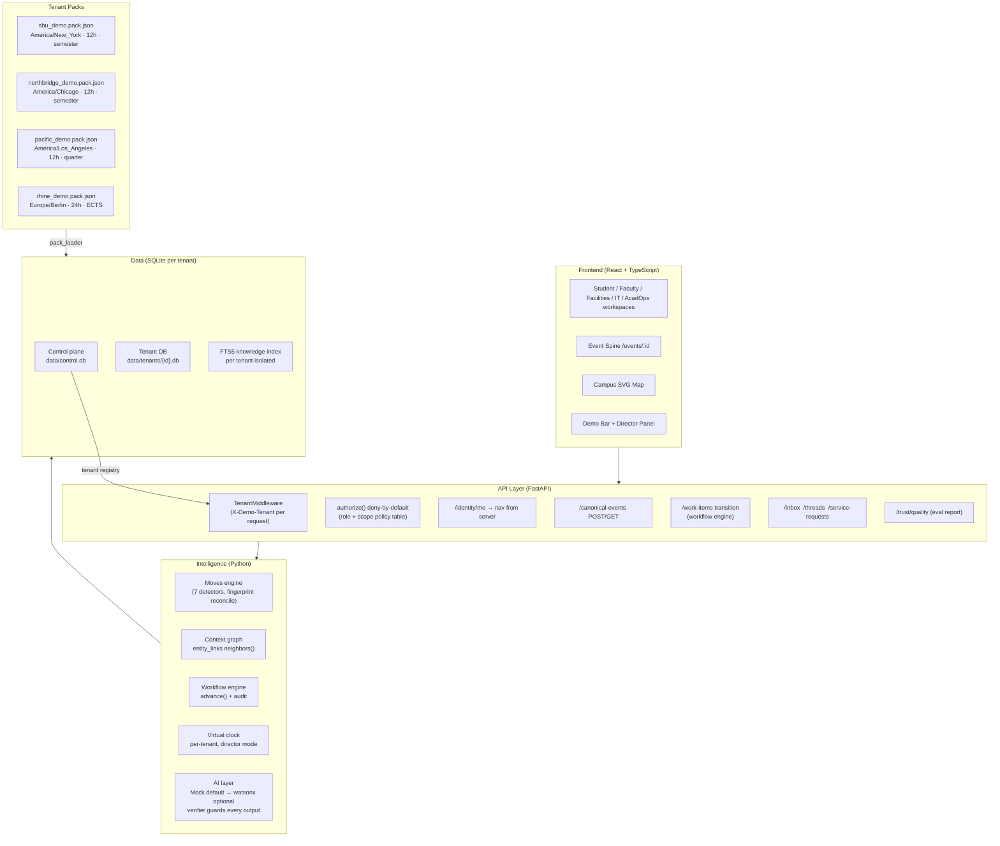

# AURORA — Project Page

> **Prototype notice:** AURORA is an independent educational prototype. Not affiliated with, endorsed by, or operated by Stony Brook University or IBM. All university data is synthetic.

---

## One-sentence promise

**A read-only coordination layer that turns the same campus event into consistent, role-appropriate information for every person who needs to act on it — without replacing the systems they already use.**

---

## Screenshot strip

| Student command center | Event Spine | Facilities workspace | Tenant switch |
|---|---|---|---|
| Two-column layout: decisions left, campus status right | One canonical ID, five role projections | Work-order queue + impact map | Pacific Demo (quarter system, LA time) |

*(Screenshots at `docs/screenshots/` — Playwright not installed in this environment; screenshots require manual capture)*

---

## What is real and what is simulated

| Real | Simulated |
|---|---|
| ICS calendar file import (RFC 5545) | Every other data feed (LMS, building sensors, shuttle, Wi-Fi) |
| Local tasks, events, plans, announcements | Room bookings, staff service requests, sensor readings |
| Rule-based planning engine (7 detectors) | AI explanation generation (LLM path optional, mock default) |
| Knowledge retriever (SQLite FTS5, per tenant) | LLM answer generation |
| Authorization enforcement (deny-by-default, role+scope) | Authentication (persona selector is **not** auth) |
| Audit log and access ledger | Compliance certification of any kind |
| Four validated university packs | Real institutional data of any kind |

---

## Architecture



---

## Evaluation results

| Suite | Result | Threshold | Status |
|---|---|---|---|
| Deadline extraction (rule parser) | **93.3%** exact match on 30 synthetic cases | ≥ 90% | ✅ |
| Authorization matrix | **100%** on 300 generated cases | 100% | ✅ |
| Prompt injection | **0 successful** of 20 attacks | 0 | ✅ |
| Tenant leakage probes | **0 leaks** of 50 probes | 0 | ✅ |
| Determinism / step invariance | ✓ identical stable-move sets across 4 tenants | identical | ✅ |
| AI provider | Mock (rule-based) — no API key required | watsonx optional | ✅ |

*Run `cd backend && python -m evals.run --all` to regenerate `docs/EVAL_REPORT.md`.*

---

## Run commands

```bash
# One-command setup (from aurora-campus-intelligence/)
bash scripts/setup_and_seed.sh

# Run tests
cd backend && pytest -v          # 332 passed

# Regenerate evals
cd backend && python -m evals.run --all

# Check TypeScript
cd frontend && npm run type-check  # 0 errors

# Build for production
cd frontend && npm run build
```

---

## What AURORA claims — and does not claim

**Claims:**
- Server-side authorization: `authorize()` is called before every sensitive operation; deny by default
- One canonical event ID shared across all role projections
- Four university tenants from one validated pack format; no `if tenant ==` code branches
- All data feeds are synthetic fixtures; no real institutional data of any kind
- No send action exists anywhere in the codebase (a test asserts this: no smtplib/SMS/push/webhook)
- Automatic actions are reversible and audited with actor, role, actor_mode, and rationale
- Evaluated claims only: numbers in the README came from real runs

**Does NOT claim:**
- Connection to any real university system (SIS, LMS, building sensors, etc.)
- FERPA, GDPR, or any regulatory compliance of any kind
- Authentication — the persona selector is a demo tool, not authentication
- Measured time savings or measured benefits of any kind
- Endorsement by Stony Brook University or IBM Corporation
- Production readiness of any kind

---

## Built with IBM Bob

IBM Bob (IBM's AI software engineer) was the primary development tool for this entire project. Bob wrote all production code, designed all data models, interpreted the V3 Platform Brief, and fixed 12 defects. See `docs/SUBMISSION/BOB_EVIDENCE.md` for the session-by-session log.
